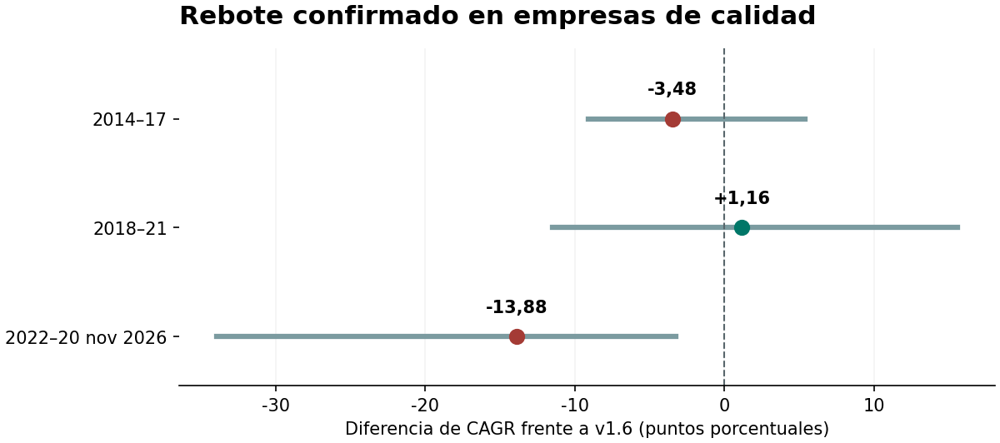

# Rebotes semanales en empresas de calidad

**Decisión de investigación · 23 de noviembre de 2026.** El rebote confirmado junto a la SMA de 200 semanas perdió frente a v1.6 en 17 de los 20 arranques de 2014–17 y en los 20 de 2022–26. En 2018–21 ganó diez y perdió diez. La réplica con empresas ajenas a InvestorAce también arroja un exceso mediano negativo frente a SPY en los tres periodos.

## ¿Mejora la cartera?

Cada celda muestra **gana/empata/pierde** por capital final sin redondear y **diferencia mediana de CAGR en puntos porcentuales**. Se hicieron 20 arranques separados por cinco sesiones en cada periodo. Los 20 utilizan casi los mismos años de mercado. Los recuentos describen sensibilidad a la fecha de inicio. No estiman una probabilidad futura.

| Variante | 2014–17 | 2018–21 | 2022–20 nov 2026 |
|---|---|---|---|
| Calidad + rebote SMA200 | 3/0/17 · -3,48 | 10/0/10 · +1,16 | 0/0/20 · -13,88 |
| Calidad + cruce literal de la SMA200 | 11/0/9 · +0,02 | 13/0/7 · +3,98 | 2/0/18 · -11,77 |
| Calidad + toque, sin confirmar el rebote | 5/0/15 · -1,41 | 19/0/1 · +6,14 | 3/0/17 · -7,84 |
| Rebote sin exigir calidad | 3/0/17 · -3,03 | 15/0/5 · +3,57 | 0/0/20 · -16,02 |
| Calidad + rebote, sin stop | 5/0/15 · -3,62 | 10/0/10 · +0,18 | 0/0/20 · -19,50 |
| Exploratoria · SMA40 semanal | 2/0/18 · -4,80 | 9/0/11 · -0,65 | 4/0/16 · -8,50 |
| Exploratoria · mantener 13 semanas | 6/0/14 · -1,28 | 11/0/9 · +1,09 | 2/0/18 · -13,14 |



El punto marca la mediana de los 20 arranques. La línea abarca del peor al mejor resultado observado.

| Periodo | CAGR v1.6 (%) | CAGR con rebote (%) | Δ caída máxima (pp) | Δ Sharpe | Compras de rebote |
|---|---|---|---|---|---|
| 2014–17 | 20,15 | 16,48 | -2,16 | -0,17 | 13,0 |
| 2018–21 | 33,92 | 34,23 | +0,62 | +0,04 | 23,0 |
| 2022–20 nov 2026 | 33,11 | 20,79 | +2,58 | -0,31 | 48,0 |

Los CAGR de cada cartera y el número de compras son medianas. Las diferencias de CAGR, caída máxima y Sharpe se calculan primero entre cada pareja y después se toma la mediana. Un Δ de caída máxima positivo indica una pérdida máxima menos profunda. Ambas carteras parten de 10.000 unidades monetarias. El universo, el calendario y los precios de cada pareja son idénticos.

## ¿Qué compra la regla?

- **Tendencia previa.** La SMA200 de cierres semanales sube frente a 26 semanas antes. El cierre previo queda sobre su media y al menos uno de los 13 cierres anteriores estuvo un 10 % o más sobre su media de entonces.
- **Toque y confirmación.** El rango de la semana entra en la banda de ±2 % alrededor de la SMA200 conocida al comenzar la semana. El cierre queda sobre la línea o en ella y supera el cierre semanal anterior. El control de toque literal exige que el rango incluya el valor exacto de la media. En el control sin confirmación basta el toque.
- **Calidad contable.** Se usa el último 10-K disponible antes del día de señal, con antigüedad máxima de 550 días desde el cierre fiscal. Se exige beneficio neto positivo en ambos ejercicios, beneficio sobre activos finales ≥5 % en el más reciente y flujo operativo superior al gasto en activos productivos en ambos. Las cifras comparativas proceden del mismo informe. Se prioriza el gasto en activos productivos y se admite la etiqueta de compras de inmovilizado material cuando falta la más amplia. Los importes ausentes dejan el caso sin clasificar. Es una definición reproducible de calidad distinta de la puntuación completa de InvestorAce.
- **Ejecución.** Compra al cierre de la siguiente sesión estadounidense, incluso en corrección. La cartera v1.6 tiene prioridad sobre el efectivo. Hasta tres rebotes, 12,5 % del patrimonio por entrada como máximo, sin apalancamiento y con una reserva de caja del 3 % del capital inicial. Si coinciden señales se prioriza el cierre más cercano a la media, con desempate alfabético. Una entrada con cotización ausente se cancela.
- **Salida.** Tras un cierre diario un 8 % bajo la entrada, un cierre semanal bajo la media conocida o 26 semanas naturales, la venta se ejecuta al siguiente cierre disponible. Las órdenes pendientes sobreviven a días sin precio. Los saltos pueden superar el stop. La posición representa un riesgo teórico del 1 % a una caída del 8 % antes de costes. La variante sin stop conserva el tamaño nominal.
- **Costes.** 0,10 % por lado. Precios ajustados por dividendos y desdoblamientos. Exceso por operación contra SPY ajustado y sin costes en exactamente las mismas sesiones. El régimen de v1.6 utiliza el índice de precios S&P 500. Los cálculos no incluyen fiscalidad personal, remuneración de la caja ni deslizamiento adicional.

## ¿Qué ocurre por operación?

La regla se prueba también sin competencia por el capital, admitiendo una operación abierta por valor. Una posición que sigue abierta al terminar un periodo se marca como censurada y se excluye de la media de operaciones cerradas. La cartera sí incorpora su valoración al cierre del periodo. El filtro por operaciones exige al menos 30 cierres, media y mediana de exceso positivas en los tres periodos.

| Universo | Periodo | Cerradas | Empresas | Abiertas al corte | Rentab. media (%) | Exceso medio (pp) | Exceso mediano (pp) | Supera SPY (%) | Peor operación (%) |
|---|---|---|---|---|---|---|---|---|---|
| InvestorAce | 2014–17 | 16 | 12 | 2 | 4,98 | +2,16 | -1,80 | 43,8 | -12,88 |
| InvestorAce | 2018–21 | 34 | 21 | 3 | 7,78 | +0,76 | -2,06 | 41,2 | -13,43 |
| InvestorAce | 2022–20 nov 2026 | 108 | 50 | 3 | 1,67 | -1,60 | -4,81 | 25,0 | -17,38 |
| Réplica S&P 500 | 2014–17 | 34 | 21 | 3 | -0,74 | -3,40 | -4,99 | 20,6 | -14,47 |
| Réplica S&P 500 | 2018–21 | 52 | 32 | 3 | 4,16 | -0,92 | -5,08 | 34,6 | -17,22 |
| Réplica S&P 500 | 2022–20 nov 2026 | 89 | 44 | 3 | 2,55 | -1,10 | -3,42 | 32,6 | -16,20 |

## ¿Es especial la línea de 200 semanas?

Para cada entrada de calidad se buscó otra empresa elegible con una semana alcista en la misma fecha, tendencia previa ascendente, mínimo al menos 5 % sobre su propia media y cierre hasta 20 % sobre ella. Entre ellas se eligió la más próxima por caída desde su máximo de cierre de las 13 semanas previas. En ambas se midió el rendimiento a 13 semanas, con los mismos costes, sin usar información futura para elegir la pareja. Un control puede repetirse. En la columna frente a SPY solo es necesario el precio futuro de la empresa original y del índice.

| Universo | Periodo | Casos con 13 semanas | Exceso mediano vs SPY (pp) | Pares válidos | Diferencia mediana vs empresa comparable (pp) |
|---|---|---|---|---|---|
| InvestorAce | 2014–17 | 17 | +1,00 | 16 | +2,63 |
| InvestorAce | 2018–21 | 33 | +4,09 | 28 | +5,27 |
| InvestorAce | 2022–20 nov 2026 | 107 | -2,73 | 99 | +0,35 |
| Réplica S&P 500 | 2014–17 | 35 | +2,01 | 31 | +2,89 |
| Réplica S&P 500 | 2018–21 | 49 | +2,02 | 44 | +5,26 |
| Réplica S&P 500 | 2022–20 nov 2026 | 88 | +0,77 | 84 | +1,20 |

Frente a otras empresas de calidad que también rebotaban, el toque de la SMA200 mostró una diferencia mediana positiva en las seis celdas. La comparación contra SPY y la simulación con capital limitado son pruebas distintas. La tabla de cartera incluye por eso una variante exploratoria que mantiene el rebote 13 semanas, prescinde del stop y de la salida por ruptura, y vende al siguiente cierre tras vencer el plazo. La variante de 40 semanas mantiene las condiciones de la estrategia principal y cambia la longitud de la media. Estas comprobaciones exploratorias se incorporaron tras inspeccionar los primeros resultados. La salida a 13 semanas consiguió excesos medianos por operación de +2,96, +2,59 y +0,44 pp en la réplica, mientras que en InvestorAce el último periodo dio −3,12 pp. Sufrió una operación de −47,12 % en la réplica. Ningún periodo es una validación prospectiva.

## Cobertura y sesgos

| Universo | Periodo | Nombres candidatos | Con SMA200 utilizable | Con calidad evaluable | Cumple calidad alguna semana |
|---|---|---|---|---|---|
| InvestorAce | 2014–17 | 128 | 79 | 57 | 43 |
| InvestorAce | 2018–21 | 128 | 88 | 67 | 51 |
| InvestorAce | 2022–20 nov 2026 | 128 | 110 | 87 | 66 |
| Réplica S&P 500 | 2014–17 | 150 | 99 | 75 | 47 |
| Réplica S&P 500 | 2018–21 | 150 | 118 | 97 | 64 |
| Réplica S&P 500 | 2022–20 nov 2026 | 150 | 128 | 103 | 73 |

InvestorAce aportó 128 símbolos. 125 ofrecían las 320 sesiones mínimas exigidas para el simulador de cartera. Los tres excluidos fueron SPCX, JEQE y ANT. v1.6 conserva el tratamiento original de posiciones en moneda local, sin conversión histórica de divisas. Las nuevas compras semanales se restringen a valores cotizados en USD y la calidad exige estados US-GAAP en USD. La tabla cuenta cada empresa una vez por periodo si ofreció alguna semana utilizable. Los integrantes actuales de InvestorAce están sujetos a selección retrospectiva.

La réplica parte de los componentes históricos del S&P 500 al inicio de cada periodo. Tras excluir los símbolos de InvestorAce, se toman los primeros 150 por un orden hash fijo e independiente del resultado. Sumaron 208 símbolos distintos, con solapamiento entre periodos. Faltó toda la historia descargable de 52, incluidos valores retirados de cotización. Las empresas permanecen en su cesta inicial durante el periodo. La resolución de símbolos históricos y los retornos de exclusión son incompletos. Estas limitaciones impiden tratar el ejercicio como una réplica libre de sesgo de supervivencia. No se asignaron rentabilidades cero ni se repusieron los nombres ausentes. Los campos SEC faltantes también pueden depender del sector, la antigüedad o la taxonomía del emisor.

## El caso de Nvidia

El 20 de noviembre de 2026, la SMA200 conocida antes de empezar la semana valía **123,33 USD**. Al incorporar el cierre semanal pasó a **123,87 USD**. El mínimo fue **124,50 USD** y el cierre **125,53 USD**, frente a 162,85 USD la semana previa. Entró en la banda del 2 % y la empresa cumplía el filtro de calidad. La cotización se mantuvo sobre la línea exacta y el cierre semanal siguió bajando. La estrategia confirmada no dio entrada. Se excluyó del estudio toda barra posterior al viernes 20.

## Datos, auditoría y reproducción

La fuente de precios es Yahoo Finance Chart, desde enero de 2005 hasta el cierre del 20 de noviembre de 2026. Los indicadores semanales se calculan con cierres de semanas completas. Los precios de máximo y mínimo se llevan a la base del cierre ajustado. Se calcula cada semana con el calendario real del S&P 500, incluidos los viernes festivos. Los hashes por serie normalizada están en los archivos de cobertura. El panel tiene una ventana de calentamiento más extensa que el informe anterior de 14 años y se descargó de nuevo. La pareja de v1.6 de este estudio es la comparación válida.

- [480 simulaciones individuales](results/portfolio_runs.csv) · [Resumen por variante](results/portfolio_summary.csv) · [Semanas de NVDA](results/nvda.csv)
- InvestorAce · [Operaciones](results/core_trades.csv) · [Todas las señales](results/core_signals.csv) · [Estados contables y números de presentación](results/core_annuals.csv) · [Controles a 13 semanas](results/core_controls.csv) · [Cobertura](results/core_coverage.csv)
- Réplica · [Muestra fijada](replication.csv) · [Operaciones](results/external_trades.csv) · [Controles](results/external_controls.csv) · [Cobertura](results/external_coverage.csv)
- Fuentes · [Precios ajustados de Yahoo](https://help.yahoo.com/kb/SLN28256.html) · [API de estados financieros de la SEC](https://www.sec.gov/search-filings/edgar-application-programming-interfaces) · [Composición histórica, versión utilizada](https://github.com/fja05680/sp500/tree/a2430f2af0c79ddf0748e91de11bdeb1616ab5a7)

Desde la raíz del repositorio, con Python 3.11+, pandas, NumPy y matplotlib, estos comandos reconstruyen el estudio. Las dos descargas pueden omitirse si se dispone de la copia congelada de los insumos en `studies/weekly200/cache/`. El proveedor puede revisar precios después del estudio.

```bash
python -m studies.weekly200.download
python -m studies.weekly200.replication_data
python -m studies.weekly200.run
python -m studies.weekly200.run --sample external
python -m studies.weekly200.report
python -m unittest studies.weekly200.test_weekly test_start_offsets test_rebound_backtest test_backtest
```
